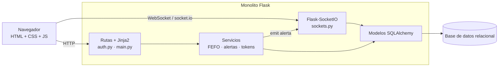
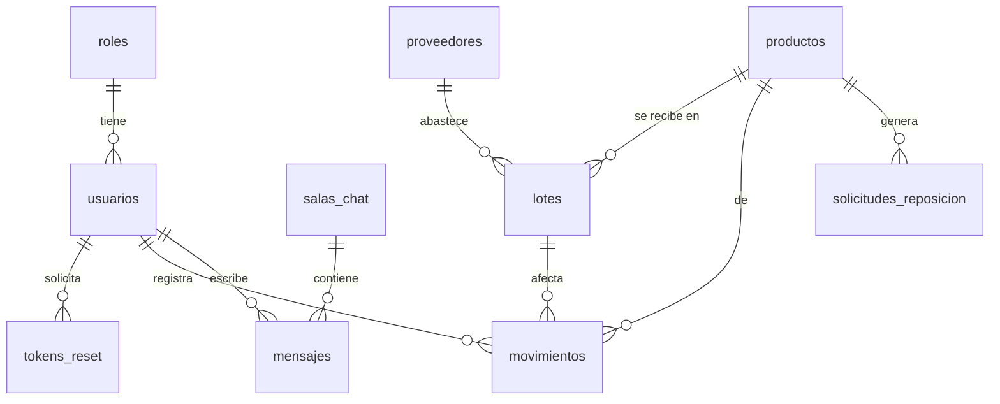

# Sistema web de inventario, lotes y reabastecimiento — Bimestre 1 (monolito)

Aplicaciones Web Avanzadas · EPN · versión de entrega: **v1.0-b1**

## 1. PYME y problema
**Distribuidora Andina** (PYME *ficticia*, distribuidora de alimentos no perecibles y bebidas; los datos del sistema son de demostración).
Controla sus existencias en hojas de cálculo: se pierde mercadería por caducidad, hay desabastecimientos que se detectan tarde y bodega y ventas
se coordinan por mensajes sueltos. La aplicación centraliza productos, lotes y movimientos, prioriza el despacho por fecha de caducidad (FEFO),
alerta en tiempo real cuando el stock llega al mínimo o un lote está por caducar, y ofrece un chat interno.

**Objetivo general:** construir una aplicación web monolítica que controle inventario por lotes y notifique en tiempo real eventos críticos.
**Objetivos específicos:** (1) autenticación segura con roles; (2) CRUD paginado de productos y registro de lotes/movimientos con FEFO;
(3) alertas de stock mínimo y caducidad por WebSocket; (4) chat con salas, historial persistido y usuarios conectados; (5) pruebas automatizadas y medición de rendimiento.

## 2. Stack
Python 3.11+ · Flask · Jinja2 (vistas en servidor) · SQLAlchemy (SQLite por defecto; PostgreSQL vía `DATABASE_URL`) · Flask-Login · Flask-WTF (CSRF + validación) ·
**Flask-SocketIO** (servidor WebSocket propio, `async_mode=threading` con `simple-websocket`) · bcrypt · pytest. Cliente socket.io incluido localmente (`app/static/vendor`).

## 3. Cómo ejecutarlo
```bash
python -m venv venv && source venv/bin/activate        # Windows: venv\Scripts\activate
pip install -r requirements.txt
cp .env.example .env                                   # edita SECRET_KEY
flask --app run seed                                   # datos de demostración (imprime la contraseña demo)
python run.py                                          # http://127.0.0.1:5000
pytest                                                 # pruebas automatizadas
python scripts/medir_rendimiento.py                    # medición de tiempos de consulta
```
Usuarios demo del `seed`: `admin@demo.local`, `bodega@demo.local`, `ventas@demo.local` (misma contraseña, definida en `SEED_PASSWORD` o generada al azar y mostrada en consola).
**Recuperación de clave:** el correo está *simulado*; el enlace aparece en la consola del servidor (`[CORREO SIMULADO]`).

### Variables de entorno (`.env.example`)
`SECRET_KEY`, `DATABASE_URL`, `COOKIE_SECURE`, `RESET_TOKEN_MINUTOS`, `DIAS_ALERTA_CADUCIDAD`, `SEED_PASSWORD`, `HOST`, `PORT`, `FLASK_DEBUG`.

## 4. Roles
| Rol | Permisos |
|---|---|
| `admin` | Todo (el único que se crea por `seed`; no se puede elegir al registrarse). |
| `bodega` | CRUD de productos, registrar entradas (lotes), proveedores, atender reposiciones. |
| `ventas` | Consultar catálogo/disponibilidad y registrar salidas. |
Todos: dashboard, movimientos, chat.

## 5. Historias de usuario
| # | Como… | quiero… | Prioridad |
|---|---|---|---|
| HU1 | usuario nuevo | registrarme con validación de datos | Alta |
| HU2 | usuario | iniciar sesión y cerrar sesión de forma segura | Alta |
| HU3 | usuario | recuperar mi clave con un enlace de un solo uso y con caducidad | Alta |
| HU4 | bodega/admin | crear, consultar, editar y eliminar (con confirmación) productos | Alta |
| HU5 | cualquier usuario | buscar/filtrar y paginar el listado de productos | Alta |
| HU6 | bodega | registrar la recepción de un lote (proveedor, cantidad, costo, caducidad, ubicación) | Alta |
| HU7 | ventas | registrar salidas y que el sistema descuente primero el lote que caduca antes (FEFO) | Alta |
| HU8 | usuario conectado | recibir alertas en vivo de stock mínimo y lotes por caducar | Alta |
| HU9 | bodega | ver y atender solicitudes de reposición generadas automáticamente | Media |
| HU10 | usuario | chatear en salas con historial y ver quién está conectado | Alta |
| HU11 | usuario | consultar el historial de movimientos | Media |

## 6. Arquitectura (monolito)

Capas: presentación (plantillas Jinja2) → controladores (blueprints) → servicios (reglas de negocio) → modelos/persistencia. El servidor WebSocket vive en el mismo proceso y comparte sesión con Flask-Login.

## 7. Modelo de datos (esquema documentado)

| Tabla | Campos principales | Índices / restricciones |
|---|---|---|
| `roles` | id, nombre | `nombre` único |
| `usuarios` | id, nombre, email, password_hash (bcrypt), rol_id, activo, creado_en | `email` único e indexado |
| `tokens_reset` | id, usuario_id, token_hash (SHA-256), expira_en, usado | `token_hash` único, índice en `usuario_id` |
| `proveedores` | id, nombre, ruc, telefono | `ruc` único |
| `productos` | id, sku, nombre, descripcion, stock_minimo, unidad, estado | `sku` único; índices en `nombre`, `estado` |
| `lotes` | id, codigo, producto_id, proveedor_id, cantidad_inicial, cantidad_disponible, costo_unitario, fecha_ingreso, fecha_caducidad, ubicacion, estado | único (`producto_id`,`codigo`); índices en `codigo`, `producto_id`, `fecha_caducidad` |
| `movimientos` | id, tipo (ENTRADA/SALIDA), producto_id, lote_id, cantidad, usuario_id, motivo, fecha | índices en `tipo`, `producto_id`, `fecha` |
| `solicitudes_reposicion` | id, producto_id, cantidad_sugerida, estado, creada_en, atendida_en | índices en `producto_id`, `estado` |
| `salas_chat` | id, nombre | `nombre` único |
| `mensajes` | id, sala_id, usuario_id, contenido (≤500), creado_en | índice compuesto (`sala_id`,`creado_en`) |

Las tablas se crean al iniciar (`db.create_all()`); las salas *General*, *Bodega*, *Ventas* y los roles se crean automáticamente.

### Reglas de negocio
- **FEFO:** una salida consume lotes aptos ordenados por caducidad más próxima (los que no caducan van al final). Es *apto* un lote `disponible`, con stock y no vencido.
- Tras **cada** movimiento se evalúan alertas: stock disponible ≤ stock mínimo (y se crea una solicitud de reposición pendiente, sin duplicarla) y lotes que caducan en ≤ `DIAS_ALERTA_CADUCIDAD` días. Se emiten por WebSocket (`alerta`) a todos los usuarios conectados.
- Un producto con lotes no se elimina (conserva el historial): se marca como inactivo.

## 8. Seguridad
| Medida | Dónde |
|---|---|
| Contraseñas con **bcrypt** (hash + sal aleatoria), nunca en claro | `models.Usuario.set_password` |
| Rutas protegidas (`login_required`) y por rol (`roles_required`, 403) | `main.py` |
| Cookie de sesión `HttpOnly`, `SameSite=Lax`, `Secure` con `COOKIE_SECURE=1`; sesión de 2 h | `config.py` |
| **CSRF** en todos los formularios y POST (Flask-WTF) | `extensions.csrf` |
| **SQL injection:** SQLAlchemy con consultas parametrizadas; comodines de búsqueda escapados | `main._like` |
| **XSS:** autoescape de Jinja2; el chat pinta con `textContent` | `chat.js` |
| Validación en **cliente** (atributos HTML5) y **servidor** (WTForms) | `forms.py` |
| Token de recuperación aleatorio, solo se guarda su hash, un solo uso, caduca (30 min), invalida los anteriores | `services.crear_token_reset` |
| Mensajes de login y recuperación genéricos (no revelan si el correo existe) | `auth.py` |
| Redirección `next` solo a rutas internas | `auth._destino_seguro` |
| **WebSocket:** autenticación en el handshake (conexión rechazada sin sesión), mismo origen por defecto, mensajes validados (tipo, 1–500 caracteres, sin caracteres de control, sala unida) | `sockets.py` |
| Secretos en variables de entorno; `.env` fuera del repositorio | `.env.example`, `.gitignore` |
| `wss` en despliegue: terminar TLS en un proxy y activar `COOKIE_SECURE=1` (ver abajo) | — |

**Ejemplo Nginx (TLS + WebSocket):**
```nginx
location / {
  proxy_pass http://127.0.0.1:5000;
  proxy_http_version 1.1;
  proxy_set_header Upgrade $http_upgrade;
  proxy_set_header Connection "upgrade";
  proxy_set_header Host $host;
}
```

## 9. Pruebas
`pytest` ejecuta **17 pruebas** (`tests/`): validaciones de registro, hash bcrypt con sal, login, rutas protegidas, token de un solo uso y expiración, CRUD de producto,
paginación y búsqueda, FEFO (excluyendo vencidos), stock insuficiente, validación de lotes, permisos por rol, rechazo de WebSocket sin sesión, chat entre dos usuarios con historial,
validación de mensajes y alerta de stock mínimo por WebSocket.

## 10. Rendimiento
- Paginación (10 por página) e índices en los campos de búsqueda/filtro (ver tabla del esquema); el chat se actualiza sin recargar la página.
- `python scripts/medir_rendimiento.py` (20 000 productos, SQLite local, 30 repeticiones). Resultado de referencia:

| Consulta | Media |
|---|---|
| Listado paginado (pág. 1) | ≈ 4 ms |
| Listado paginado (pág. 1500) | ≈ 5 ms |
| Búsqueda por prefijo de SKU | ≈ 16 ms |
| Búsqueda por nombre | ≈ 20 ms |
| Detalle por identificador | ≈ 3 ms |

- Para el informe **Lighthouse**: con el servidor en marcha, abre Chrome DevTools → Lighthouse sobre `/login` y `/productos` (con sesión) y adjunta las capturas a la presentación.

## 11. Estructura
```
app/  __init__.py  models.py  forms.py  services.py  auth.py  main.py  sockets.py  cli.py
      templates/  static/(css, js, vendor)
tests/  scripts/medir_rendimiento.py  config.py  run.py  requirements.txt  .env.example
```

## 12. Equipo y cronograma (completar)
| Integrante | Rol | Responsabilidades |
|---|---|---|
| … | Líder / backend | … |
| … | Backend / base de datos | … |
| … | Frontend / vistas | … |
| … | Tiempo real / chat | … |
| … | QA / documentación | … |

Cronograma sugerido (6 semanas): S1 análisis y modelo de datos · S2 autenticación y recuperación · S3 CRUD y lotes · S4 chat y alertas · S5 pruebas y rendimiento · S6 documentación y defensa.

## 13. Uso de IA (declaración)
Se usó **Claude (Anthropic)** como apoyo para redactar la propuesta y generar el código base, las pruebas y esta documentación. El grupo revisó, ejecutó y probó el código y puede explicarlo y modificarlo en la defensa.
*(Ajustar esta sección con el uso real de cada integrante.)*

## 14. Entrega
```bash
git tag v1.0-b1 && git push origin v1.0-b1
```
No subir `.env`, bases de datos ni credenciales reales.
